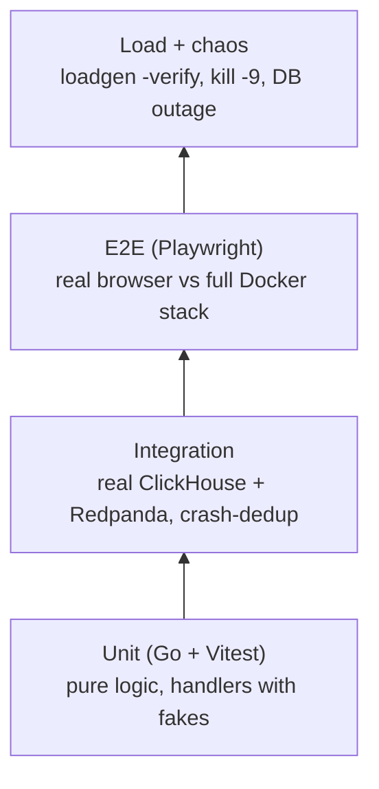

# 5. SDLC: how this project was planned, built, verified and would be run

## 1. Requirements

**Functional**
- F1. Services submit batches of request events over HTTP, authenticated per tenant.
- F2. Accepted events are stored and queryable within about 1 s.
- F3. Query KPIs (rate, error rate, p50/p95/p99) and time series over live (1–15 min) and
  historical (1 h – 7 d) windows, optionally per service.
- F4. Browse raw events newest-first with filtering and infinite scroll.
- F5. Live dashboard that updates every second.

**Non-functional (targets → measured)**

| Requirement | Target | Measured |
| --- | --- | --- |
| Throughput | ≥ 100k events/s on a laptop | 200k/s sustained, 210k/s ceiling |
| Ingest latency | p99 < 50 ms | p99 11.3 ms @ 200k/s |
| Freshness | ingest → queryable < 1 s | about 0.27 s |
| Correctness | no loss or duplicates after `202`, including crashes | verified at every load level and under `kill -9` |
| Query latency | < 100 ms over 10M+ rows | 15–27 ms over 12M rows |
| Overload behavior | degrade, don't crash | `429`/`503` with bounded memory; exactly-once held |
| Frontend | no jank at live rates | worker about 100 µs/frame; virtualized log |
| Cost | $0 | all open source, runs locally |

**Out of scope:** user management UI, arbitrary query language, multi-region.

## 2. Design
Captured in [03-architecture.md](03-architecture.md): component boundaries, the exactly-once
design, the schema, failure modes, security, and ADRs. The API contract
([api/openapi.yaml](../api/openapi.yaml)) was written **before** the handlers and generates the
types on both sides.

## 3. Implementation principles
- **Layered, dependency-inward packages:** `event` (pure domain) ← `ingest` / `sink` / `query`
  (use cases) ← `cmd/*` (wiring). Infrastructure sits behind small interfaces (`Producer`,
  `Store`, `Repository`, `LiveSource`), so handlers are tested with fakes.
- **Pure core, thin I/O shell:** the hardest logic (`sink.Prepare`, route normalization,
  validation, `ChooseStep`, LTTB, SSE parsing, series merge) is pure and exhaustively tested.
- **Configuration from the environment** with safe local defaults, validated at startup (fail fast).
- **Explicit errors, no panics** in request paths. A recovery middleware is the last line of defense.
- **Graceful shutdown:** `SIGTERM` stops accepting, drains in-flight requests, flushes the
  producer, and lets the sink finish its current batch.
- **Frontend:** heavy work in a worker; components are keyed instead of syncing state in effects;
  strict TS (`noUncheckedIndexedAccess`, `erasableSyntaxOnly`).

## 4. Testing strategy

| Level | Examples | Where it runs |
| --- | --- | --- |
| Unit | plan dedup, validation, limiter, SSE parser, LTTB, series store | every commit (CI `go`, `dashboard`) |
| Integration | ClickHouse migrations and queries, crash between write and commit | CI `go` job (compose services) |
| E2E | connect, live stream, log paging, filters, ranges | CI `e2e` job |
| Load / verification | `make verify` exactly-once check | CI `e2e` job (20k/s); higher rates manually |
| Chaos (manual) | `kill -9` sink, stop ClickHouse, overload | [04-build-and-test.md](04-build-and-test.md) step 6 |
| Security | `govulncheck`, `npm audit`, auth/limit tests | CI |

## 5. CI/CD ([.github/workflows/ci.yml](../.github/workflows/ci.yml))

| Job | Steps |
| --- | --- |
| `go` | start Redpanda + ClickHouse via compose → generated-code drift check → `gofmt` → `go vet` → `go test -race` (unit + integration) → build → `govulncheck` |
| `dashboard` | `npm ci` → type-generation drift → Prettier → `tsc` → oxlint → Vitest → build → `npm audit` |
| `e2e` | full stack with `docker compose --profile app` → `make verify` → Playwright with background load |
| `images` | on `main` only: build and push service and dashboard images to GHCR, tagged with the commit SHA |

Dependabot opens grouped update PRs; CI gates them like any other change.

> The workflow assumes `live-analytics/` is the **root of its own repository**. If it stays
> inside a larger monorepo, move the workflow to the repo root and add
> `defaults.run.working-directory: live-analytics`.

## 6. Deployment options (all with free tiers or self-hosted)

| Piece | Local (this repo) | Production-shaped |
| --- | --- | --- |
| ingest / query / sink | Compose | Kubernetes Deployments (HPA on CPU for ingest/query; sink replicas ≤ partitions) |
| Redpanda | single container, RF=1 | 3-node cluster, RF=3, or managed Kafka |
| ClickHouse | single container | ReplicatedMergeTree + Keeper, or ClickHouse Cloud |
| Dashboard | nginx container | Any static host/CDN (the CSP `connect-src` is set from `CSP_CONNECT_SRC`) |
| Secrets | `.env` | Kubernetes Secrets / a secrets manager. Rotate API keys by adding the new one, migrating clients, then removing the old one. |

Probes: `/healthz` (liveness: process up) and `/readyz` (readiness: dependencies reachable) on
every service.

## 7. Operations runbook

**Dashboards and alerts to set up (Prometheus metric → alert):**

| Signal | Metric | Alert when |
| --- | --- | --- |
| Sink falling behind | `sink_consumer_lag_records` | growing for 5 min |
| Freshness | `sink_ingest_to_queryable_seconds` (p99) | > 5 s |
| Storage failures | `sink_write_duration_seconds` count stalls + error logs | no writes for 1 min while lag > 0 |
| Poison data | `sink_dead_lettered_total` | any increase |
| Client pain | `ingest_requests_total{code=~"429|503"}` | > 5% of requests |
| Ingest latency | `ingest_produce_duration_seconds` p99 | > 100 ms |
| Query latency | `query_duration_seconds` p99 | > 500 ms |

**Common incidents**

- **Lag growing:** check sink logs for `operation failed; retrying` → ClickHouse health / disk.
  Scale sink replicas (up to the partition count).
- **DLQ increasing:** `rpk topic consume events.dlq -n 5` shows the payload and an `error`
  header with its source `topic/partition/offset`. Fix the producer; replay if needed.
- **Many 429s for one tenant:** a legitimate spike → raise that tenant's limit; abuse → rotate
  its key.
- **Disk pressure on ClickHouse:** TTLs remove old data automatically. Check
  `system.parts` for the largest tables.

## 8. Roadmap
- Per-tenant limits and quotas stored in a database, not env config.
- Client SDK (Go/TS) with batching, gzip, retry with idempotent `eventId`, and server-side
  dedup of client retries (e.g. a `ReplacingMergeTree` keyed by `eventId`, or a short-TTL
  seen-set).
- Alerting rules evaluated in the query service, pushed over SSE.
- Kubernetes manifests / Helm chart and a k6 or Grafana dashboard pack.
- ClickHouse sharding by tenant for multi-node scale.
