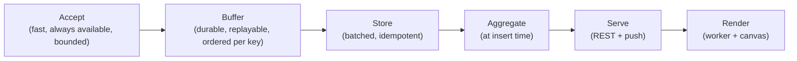
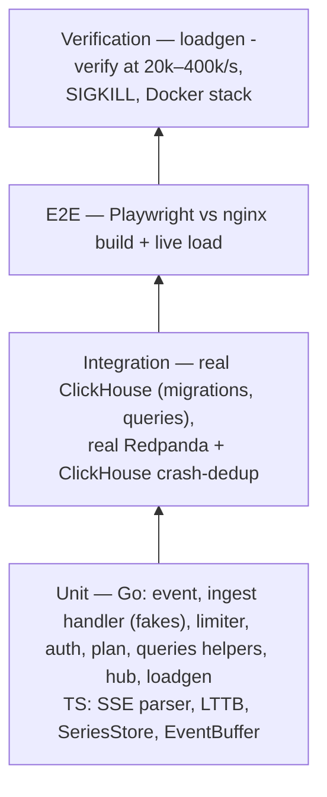
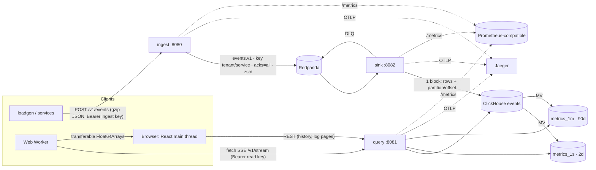
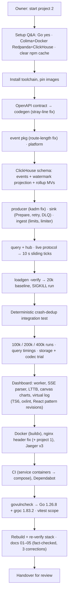

# 06: Development history and engineering retrospective

This is a technical case study of how Live Analytics was designed, built, measured, corrected and
finished. Docs 01–05 describe the finished system. This one explains how it got that shape, the
alternatives, what went wrong, and what generalizes.

---

## 0. Evidence and how to read this document

**There is no git history.** The folder is not a git repository. Evidence is labeled:

| Label | Source | Reliability |
| --- | --- | --- |
| **[Code]** | This repository: Go and TS source, SQL migrations, `api/openapi.yaml`, configs, CI, docs 01–05 | Verifiable |
| **[Session]** | The recorded AI-assisted development session in which the project was built with its owner. It holds requests, commands, outputs and measurements, and is **not** in the repository. | Faithful for order and results; some raw outputs were not retained, as noted |
| **[Interpretation]** | Present-day engineering reasoning where no recorded motive exists | An explanation, **not** history |

A "why" without one of the first two labels should be read as **[Interpretation]**. §16 gives an
**order** of events, not dates.

---

## 1. Project origin and initial requirements

### 1.1 The problem

Concept 2 of the owner's four-project brief **[Session]**:

> **High-Throughput Analytics Ingestion & Live Dashboard.** An end-to-end telemetry system capable
> of ingesting event streams, running aggregate queries, and streaming live metrics.

The brief's specific expectations **[Session]**:

| Side | Brief asked for |
| --- | --- |
| Backend | "High-performance **Go or Rust** ingestion API that validates, batches, and pushes metrics into a stream buffer (e.g., **Apache Kafka or Redpanda**)" |
| Backend | "Stream consumer writing micro-batches into an analytics database like **ClickHouse or DuckDB**" |
| Backend | "**Materialized views** for pre-aggregations (P95, P99 latencies, error rates) to keep complex analytics queries **sub-100ms**" |
| Frontend | "**SSE or WebSockets** feeding high-frequency updates directly into custom charting components (using **D3.js** or Visx)" |
| Frontend | "Offload heavy data aggregation, downsampling, and charting calculations into background **Web Workers**" |
| Frontend | "Infinite-scroll **virtualized** data tables handling tens of thousands of raw logs without DOM lag" |

### 1.2 Standing constraints (from project 1, still in force) **[Session]**
Free resources only; clean architecture; the full SDLC; stop for review after the project;
docs on what it does, the stack ("only those needed"), and step-by-step build and test.

### 1.3 The environment at the start **[Session]**
- macOS arm64 with Node 20. **No Go, no Docker.** About 9.8 GB of free disk.
- The owner answered three setup questions:
  - install Go: **yes**
  - infrastructure: **Colima + Docker running Redpanda + ClickHouse**
  - clear the npm cache (2.7 GB) to free disk: **yes**
- Lighter options were presented and not chosen: NATS JetStream + DuckDB, and a "local mode"
  with the production stack behind interfaces. §3 and §12 discuss them.

### 1.4 Requirements that shaped the architecture most
1. **Throughput with correctness.** A pipeline that is fast but loses or duplicates events is
   worthless for analytics. The design target became "every accepted event stored exactly once",
   which is stricter than the brief.
2. **Sub-100 ms queries**, which requires pre-aggregation.
3. **Live updates without stalling the browser**, which requires worker-side processing and canvas
   drawing.
4. **Disk and RAM limits** (6 GB VM, a few GB free) favored single-binary infrastructure.

### 1.5 Assumptions
- Events are request observations (service, route, method, status, duration). They are simple
  enough for JSON on the wire **[Code: `internal/event/event.go`]**.
- Tenancy comes from the API key, never the payload **[Code: `ingest/handler.go` uses the
  authenticated tenant]**.
- A single node of each infrastructure component is acceptable locally. Scale-out is documented,
  not built.

### 1.6 Initial scope
Ingest API, durable stream, sink, ClickHouse schema with rollups, query API (REST + SSE), load
generator with exactly-once verification, dashboard (KPIs, live and historical charts, services
table, virtualized log), Docker, CI, docs. Out of scope: user accounts, arbitrary query language,
alerting, multi-node clusters.

---

## 2. Initial technical planning

### 2.1 Decomposition



Each stage has a different failure and scaling profile, so each became its own process or thread:
`ingest`, Redpanda, `sink`, ClickHouse materialized views, `query`, dashboard worker, and the
main thread.

### 2.2 Components planned
`api/openapi.yaml` (contract) · `internal/event` (domain) · `internal/platform` (config, auth,
logging, tracing, HTTP) · `internal/stream` (producer/admin) · `internal/sink` · `internal/store`
(migrations, writer, queries) · `internal/ingest` · `internal/query` · `internal/loadgen` +
`cmd/*` · `dashboard/`.

### 2.3 Decisions required before coding
1. **Where exactly-once comes from.** Kafka gives at-least-once to external systems. Something had
   to make ClickHouse writes idempotent.
2. **The wire format for events** in the stream (JSON vs Avro/Protobuf).
3. **The partitioning key** (ordering vs spread).
4. **The aggregation strategy** (at query time, at insert time, or in a stream processor).
5. **The live push protocol and its auth** (EventSource can't send headers).
6. **One contract for two languages** (Go server, TS client).

### 2.4 Order of construction **[Session]**
Contract → domain → platform → storage → stream → sink → ingest → query → load generator →
dashboard → containers → CI → docs. The contract came first so generated types existed before any
handler. Storage came before the sink so the idempotency design (watermarks) was fixed in the
schema before consumer code depended on it.

---

## 3. Technology and architecture selection

| Area | Chosen | Alternatives | Why it fits this project | Cost accepted |
| --- | --- | --- | --- | --- |
| Services | **Go 1.26** (std `net/http` routing) | Rust (brief); Node | Brief named Go/Rust. Go gives cheap goroutines per request, a static binary for distroless images, good Kafka/ClickHouse clients, and fast builds. | GC. Irrelevant at measured latencies (p99 11 ms at 200k/s). |
| Stream | **Redpanda** (Kafka API) | Apache Kafka; NATS JetStream **[Session: considered]** | Kafka protocol without a JVM/ZooKeeper fits a 6 GB VM. Kafka API portability: swapping to Kafka/MSK needs no code change. | Another container. Single node locally (RF=1). |
| OLAP | **ClickHouse** | DuckDB **[Session: considered]**; TimescaleDB | Brief named ClickHouse/DuckDB. ClickHouse has server-side **materialized views, AggregatingMergeTree, t-digest states, projections, TTL**, and concurrent readers and writers. DuckDB is in-process (one writer) and has no incremental MVs. | Heavier to run; operational knowledge needed |
| Kafka client | **franz-go** (`kgo`, `kadm`, `kotel`) | confluent-kafka-go (cgo); segmentio/kafka-go | Pure Go (no cgo in distroless). `BlockRebalanceOnPoll`, manual commits and assign callbacks, all needed for §6 D4. | API surface is large |
| ClickHouse client | **clickhouse-go v2** (native) | HTTP interface | Native columnar blocks for inserts; typed server-side parameters | — |
| Contract | **OpenAPI 3 + oapi-codegen + openapi-typescript** | Hand-written types; gRPC | One spec, two generated type sets; CI fails on drift | TS 6 peer-dependency friction (§5.6) |
| Push | **SSE over `fetch`** | WebSocket; native `EventSource` | One-way flow; plain HTTP. `fetch` because **EventSource can't send `Authorization`** **[Session]** | Must parse SSE manually (`sse-parser.ts`) |
| Charts | **Canvas + d3-scale/shape/array** | SVG with D3/Visx | Brief allowed D3/Visx. D3 is used for math only; canvas avoids thousands of DOM nodes per second. | Custom hit-testing and hover |
| Worker transport | **Transferable `Float64Array`s** | Structured clone of objects | Zero-copy handoff each frame | Column-oriented data shape |
| Log table | **@tanstack/react-virtual** | react-window; hand-rolled | Brief asked for virtualization. Maintained; headless. | React Compiler advisory warning (not an error) |
| Observability | **OpenTelemetry, Prometheus, slog** | Vendor SDKs | Free, standard, local Jaeger; trace context through Kafka headers (`kotel`) | — |
| Delivery | **Distroless nonroot image, nginx, Compose, GitHub Actions, Dependabot** | Alpine runtime; Docker Desktop | Small attack surface (116 MB image, no shell); Colima is free | Debugging distroless needs ephemeral containers |
| Frontend lint | **oxlint** (template default) | ESLint | Very fast; includes React Compiler rules | Fewer plugins |

### 3.1 Architecture patterns
- **Log-centric pipeline:** ingest acknowledges on durable log append; everything downstream can
  replay.
- **Pure core, thin shell** in Go: `sink.Prepare`, `event.FromAPI`/`NormalizeRoute`,
  `store.ChooseStep`/`Rollup`, the limiter. Small interfaces at the edges: `ingest.Producer`,
  `sink.Store`, `query.Repository`, `query.LiveSource` **[Code]**.
- **Contract-first** API with generated types on both sides.
- **Main thread renders; worker computes** in the browser.

---

## 4. Implementation process

### Phase 0: Environment **[Session]**
Homebrew Go, Colima (`vz`, virtiofs, 4 CPU / 6 GB / 20 GB), docker CLI, compose. The
`~/.docker/config.json` `cliPluginsExtraDirs` entry lets the CLI find brew plugins. Images pinned:
Redpanda v26.2.3, ClickHouse 26.9.6.6, Jaeger v2.21.0 (about 1.9 GB; about 6.5 GB of disk left).

### Phase 1: Contract (`api/openapi.yaml`)
- Endpoints: `POST /v1/events`; `GET /v1/events`, `/v1/metrics/summary`,
  `/v1/metrics/timeseries`, `/v1/metrics/services`, `/v1/stream`.
- Security schemes for ingest and read keys; a partial-acceptance result
  `{accepted, rejected, errors[{index, message}]}`.
- `oapi-codegen` runs as a **`go tool`** (version pinned in `go.mod`) via `internal/api/generate.go`.
- A misplaced edit left a stray line outside the schema, and generation failed at spec line 226
  **[Session]**. It was removed and regenerated. **Lesson:** a generator is also a validator.

### Phase 2: Domain (`internal/event`)
- `Event` with compact JSON keys (for stream size); `FromAPI` (validate + normalize; tenant
  injected); `NormalizeRoute` (`/users/123?x=1` → `/users/:id`; numeric, hex and UUID segments;
  query strings stripped, to bound route cardinality in the rollups); `Validate`.
- `codec.go`: `Topic = "events.v1"` (versioned), `DLQTopic`, `Encode`/`Decode`,
  `PartitionKey = tenant/service`.
- **Bug [Session]:** route length was checked *after* normalization, so a 250-character raw route
  could collapse under the limit. The check was moved to the raw input.

### Phase 3: Platform (`internal/platform`)
`env.go` (typed env collector that accumulates **all** errors and fails at startup), `logging.go`
(slog JSON + `trace_id`), `tracing.go` (OTLP only if the endpoint is set; 10% parent-based
sampling), `auth.go` (`KeyStore` of `tenant:role:secret`, SHA-256 digests, constant-time compare),
`http.go` (`Serve` with graceful shutdown, middleware for otelhttp + recovery + nosniff + CORS,
metrics registry).

### Phase 4: Storage (`internal/store`)
- Migrations `001`–`005`: `events` (MergeTree, `ORDER BY (tenant, service, ts)`, daily partitions,
  30-day TTL, `kafka_partition`/`kafka_offset` columns and the **`kafka_watermarks` projection**);
  `metrics_1s` (2 d) and `metrics_1m` (90 d) AggregatingMergeTree tables with their MVs.
- `clickhouse.go`: `Open` (LZ4) and `Migrate` (embedded SQL, `schema_migrations`).
- `writer.go`: `Write` (one `PrepareBatch` → `Send`), `Watermarks`, `Ping`.
- `queries.go`: `Summary`, `TimeSeries` (zero-filled), `Services`, `Live` (`GROUPING SETS
  ((bucket), (bucket, service))` over the last 10 s), `RecentEvents`, `ListEvents` (keyset cursor),
  `Rollup`, `ChooseStep`. **All values are bound as `{name:Type}` server-side parameters.**

### Phase 5: Stream (`internal/stream`)
`NewProducer`: all-ISR acks, zstd, 5 ms linger, bounded buffer. `EnsureTopics` for the topic and
DLQ (12 partitions, RF from env). `TracingHooks()` (kotel). **Bug [Session]:** the code called a
non-existent `kadm.NewClientWithClient`; compilation pointed to `kadm.NewClient`.

### Phase 6: Sink (`internal/sink`)
- `plan.go`: pure `Prepare(records, watermarks) Plan`.
- `sink.go`: `Run` loop (poll ≤ `MaxBatch` or `FlushInterval` → process → allow rebalance),
  watermark reload on assignment, DLQ, generic `retry` with 200 ms → 10 s backoff. `commit` is a
  **swappable field** so a test can simulate a crash between write and commit (Phase 10).
- `metrics.go`: rows, duplicates, dead-lettered, write seconds, batch rows, ingest-to-queryable,
  lag per partition.

### Phase 7: Ingest (`internal/ingest`)
The handler pipeline (order matters, §8.1) and `TenantLimiter` built on `rate.ReserveN` so it can
return an exact `Retry-After`. **Tooling hiccup [Session]:** `go mod tidy` removed modules that
weren't imported *yet* (ClickHouse, later `x/time/rate`). They were re-added once used.

### Phase 8: Query (`internal/query`)
`server.go` wraps REST routes in `http.TimeoutHandler` (not the stream), validates parameters,
and streams SSE via `http.NewResponseController` (flush per message, ping every 15 s). `hub.go`
runs one poller per tenant (§15.3). `mapping.go` converts store rows to API types.

### Phase 9: Load generator (`internal/loadgen`, `cmd/loadgen`)
Log-normal latencies, 8 services, periodic "incidents" (error and latency spikes); open-loop
pacing; honors `Retry-After`; gzip; `-verify` compares stored-count deltas against accepted count.

### Phase 10: Measurement and the deterministic crash test
First runs (§7), then a live `SIGKILL` of the sink (499,500 accepted = stored **[Session]**). A
random kill doesn't prove the **critical window** (after the ClickHouse insert, before the commit)
was ever hit. The swappable `commit` enabled
`TestCrashBetweenWriteAndCommitIsDeduplicated` **[Code: `sink_integration_test.go`]**: sink A
writes 3,000 events and "crashes" before committing; sink B receives all 3,000 again and **skips
all 3,000** **[Session]**.

### Phase 11: Dashboard
Scaffolded with Vite + React + TS 6 on port 5174 (5173 belongs to project 1).
- `src/api/` (generated `schema.gen.ts`, typed `client.ts`, `ApiError`, `trace.ts` for
  `traceparent`).
- `src/live/`: `sse-parser.ts`, `live.worker.ts`, `series-store.ts`, `event-buffer.ts`,
  `lttb.ts`, `protocol.ts`, `use-live-feed.ts`.
- `src/charts/`: `TimeChart.tsx`, `values-at.ts`.
- `src/hooks/`: `use-poll.ts`, `use-event-log.ts`. `src/lib/emitter.ts`, `format.ts`.
- `src/components/`: `ConnectScreen`, `KpiCards`, `ServicesTable`, `LogTable`, `Dashboard`.
- Several revisions happened here (§5.6–5.9).

### Phase 12: Containers
Root multi-stage `Dockerfile` (4 binaries → distroless nonroot, 116 MB); `dashboard/Dockerfile`
(nginx with CSP template); Compose `app` profile. **Blocker [Session]:** Homebrew's docker lacked
**buildx**, which the Dockerfile's cache mounts need. Installed `docker-buildx`.

### Phase 13: Observability check
Jaeger showed services `ingest`, `sink`, `query` **[Session]** after discovering that Jaeger v2's
API lives at `/api/v3/services` (`/api/services` 404s).

### Phase 14: CI, security scanning, final checks, docs
Covered in §5.10–5.12 and §11.

---

## 5. Architecture evolution

### 5.1 Infrastructure: lighter local stack → production-shaped stack
- **Options [Session]:** NATS JetStream + DuckDB (lighter); an in-process/embedded local mode; or
  Redpanda + ClickHouse under Colima.
- **Chosen by the owner:** Redpanda + ClickHouse.
- **Consequence:** real exactly-once and OLAP behavior could be measured, not simulated. The cost
  was disk (npm cache cleared) and a VM.

### 5.2 Live feed: one "last complete second" tick → sliding 10-second window
- **Earlier [Session: spec text]:** `event: tick` carried a single `LiveTick` "for the last
  complete second".
- **Problem:** events become queryable about 0.3 s after arrival and can arrive late. A bucket
  sent once may be *incomplete*, and the client would never learn its final value.
- **Replacement [Code: `openapi.yaml`, `queries.go` `liveWindowSeconds = 10`, `series-store.ts`]:**
  `event: ticks` carries an **array covering the last 10 s**, and the client **upserts by
  timestamp**. Late data corrects recent buckets on the next tick.
- **Cost:** about 10× more tick payload per second (small: a few KB). Idempotent merging on the
  client.

### 5.3 Crash verification: random kill → deterministic fault injection
See Phase 10. The earlier approach produced a correct result without proving the dedup branch
ran. The replacement made `commit` injectable. That's a small production-code concession for a
decisive test.

### 5.4 Delivery-semantics wording
- **Earlier:** the spec implied end-to-end exactly-once.
- **Revised [Session; Code: `openapi.yaml`]:** exactly-once **after `202`**. A client retrying
  after a lost response is **at-least-once**, and `eventId` is stored so duplicates can be found.
- **Why it matters:** the claim now matches what the mechanism proves (Kafka offsets identify a
  record *after* it's in the log, not before).

### 5.5 Producer/consumer tuning under load
Between 100k/s and 400k/s runs, only **client-side load parameters** changed (batch 1,000 → 2,000,
workers 64 → 128). No evidence shows server tuning (linger, partitions, sink batch) changing
between those runs **[Session]**. Backpressure, not tuning, is what kept 400k/s safe.

### 5.6 Stream decoding in the worker: `pipeThrough(TextDecoderStream)` → reader + `TextDecoder`
- **Trigger [Session]:** a TypeScript 6 DOM-typing incompatibility on `pipeThrough`.
- **Replacement [Code: `live.worker.ts`]:** `response.body.getReader()` + `decoder.decode(value,
  { stream: true })`. It is still incremental and handles multi-byte characters split across chunks.

### 5.7 React state patterns: effect-driven state → keyed components, emitter, tagged state
- **Trigger [Session]:** oxlint's React rules flagged `Date.now()` during render, refs read during
  render, synchronous `setState` inside effects, and a Fast Refresh boundary violation.
- **Replacements [Code]:**
  - `LogTable` is **keyed by filter**, so a filter change remounts it instead of an effect
    resetting state.
  - Live-log updates flow through `lib/emitter.ts` subscriptions (`use-event-log.ts`) instead of
    effect-driven copies.
  - `use-poll.ts` tags state with its request key, so stale results are ignored without clearing
    state in an effect.
  - `valuesAt` moved to `charts/values-at.ts` so component modules only export components.
  - `LogTable` owns paused/scrolled-away state and loads more **in the scroll handler**.
- **Benefit:** fewer renders and no cascading effects; compatible with React Compiler.

### 5.8 Chart domain: explicit `domain` prop → `follow` mode + data-derived domain
- **Earlier:** callers passed a time domain.
- **Replacement [Code: `TimeChart.tsx`]:** in live mode the chart **follows the clock** via
  `requestAnimationFrame` (smooth scrolling between 1 s updates). Otherwise the domain comes from
  the data.
- **[Interpretation]:** this removes a class of caller bugs (stale domains) and keeps the live and
  historical behaviors distinct.

### 5.9 Worker cost display: ms → µs
The UI showed "0.0 ms" because the work was sub-millisecond **[Session]**. It now shows µs/frame
(about 100 µs). A metric that rounds to zero hides regressions.

### 5.10 nginx: location `add_header` → `expires`
- **Trigger [Session]:** verifying headers showed hashed assets **without CSP/nosniff**. nginx
  drops inherited `add_header`s when a location defines its own.
- **Replacement [Code: `dashboard/nginx.conf.template`]:** security headers only at server level;
  `expires 1y` for `/assets/`, `expires -1` for `/`. Applied to project 1 as well.
- **Cost:** no explicit `immutable`.

### 5.11 CI infrastructure: service containers → the project's Compose file
- **Earlier:** GitHub service containers, including a **non-existent `REDPANDA_MODE` env var**,
  because service containers can't take a start command and Redpanda needs one **[Session]**.
- **Replacement [Code: `.github/workflows/ci.yml`]:** `docker compose up -d --wait redpanda
  clickhouse`. CI now uses **the same images, flags and health checks as local dev**.

### 5.12 Toolchain and dependency security
- `govulncheck` reported stdlib advisories (Go 1.26.0: `net/http`, `crypto/tls`) → `toolchain
  go1.26.8` in `go.mod` and `golang:1.26.8-alpine` in the Dockerfile. It then reported an
  indirect `grpc` 1.83.1 advisory → 1.83.2. Result: **"No vulnerabilities found."** **[Session]**
- Vitest was collecting the Playwright spec (`e2e/`) → `test.include: ['src/**/*.test.ts']`.

---

## 6. Important engineering decisions

| # | Problem | Options | Chosen | Why here | Trade-offs and consequences |
| --- | --- | --- | --- | --- | --- |
| D1 | Absorb spikes and DB outages | Direct inserts; **log first** | **Redpanda first; `202` after `acks=all`** | Ingest availability becomes independent of ClickHouse; replay possible | Another system; ~0.27 s freshness instead of synchronous |
| D2 | Stream encoding | Avro/Protobuf + registry; **compact JSON + zstd** | **JSON** **[Session: "simpler, fast enough, no schema registry"]** | Human-debuggable (`rpk topic consume`); zstd recovers most of the size | No schema enforcement in the log; versioning via topic name `events.v1` |
| D3 | Ordering vs spread | Random; tenant; **tenant/service** | **`tenant/service`** | Per-service order kept; a busy tenant spreads over partitions | One hot service is bounded by one partition |
| D4 | Exactly-once into ClickHouse | Kafka transactions; ReplacingMergeTree on `event_id`; insert dedup tokens; external offset store; **offsets stored with rows + projection watermark** | **Watermark projection** | Rows and "how far we got" are written **atomically in one insert block** | Batches must stay one block (`MaxBatch ≤ 1M`); a restart reads 1 row per partition via the projection |
| D5 | No two writers per partition | Rely on commit timing; **`BlockRebalanceOnPoll`** | **Block rebalances between poll and commit** | Removes the only concurrency hole in D4 | Rebalances wait for the current batch (≤ 500 ms + write) |
| D6 | Commit failures | Fatal; **log and continue** | **Commit as optimization** | Correctness rests on watermarks; a lost commit only causes replay (skipped) | Replays cost fetch bandwidth |
| D7 | Aggregation | Query-time scans; Flink/stream processor; **MVs into AggregatingMergeTree** | **MVs, t-digest states** | One less system; sub-100 ms queries; mergeable percentiles | Approximate percentiles; windowing limited to buckets |
| D8 | Which table for a query | Always raw; always 1 m; **by window** | **`metrics_1s` ≤ 48 h, else `metrics_1m`; ~300 buckets** | Matches TTLs; bounded points per chart | Two code paths |
| D9 | Paging raw logs | OFFSET; **keyset `(ts, eventId)`** | **Keyset** | Deep pages cost the same as page 1; stable under inserts | No "jump to page N" |
| D10 | Push with auth | EventSource + token in URL; WebSocket; **fetch SSE** | **fetch SSE** | Keys stay out of URLs (and logs); plain HTTP | Manual parser; reconnect logic in the worker |
| D11 | Live fan-out | Poll per connection; **one poller per tenant** | **Hub with size-1 channels** | ClickHouse load scales with *tenants*, not tabs; slow clients get latest, not backlog | Snapshots can be skipped for slow clients (by design) |
| D12 | Browser CPU | Main thread; **worker + transferables + LTTB** | **Worker** | Main thread only draws; about 100 µs/frame | Message protocol to maintain (`protocol.ts`) |
| D13 | Overload | Queue; **layered shedding** | **In-flight cap (503) → per-tenant bucket (429 + Retry-After) → produce timeout (503) → bounded producer buffer** | Memory stays bounded; clients get actionable signals | Some traffic rejected at peak (by design) |
| D14 | Key storage | Plaintext; bcrypt; **SHA-256 digest + constant-time** | **SHA-256** | Keys are high-entropy random strings, so a fast hash is appropriate (bcrypt is for low-entropy passwords) **[Interpretation]** | Keys in env config, no rotation UI |
| D15 | TS strictness | Remove `erasableSyntaxOnly` (project 1 did); **keep it** | **Keep** + `strict` + `noUncheckedIndexedAccess` | Adopted from day one, it costs little: no enums or parameter properties | Slightly more verbose classes |

### 6.1 Why the watermark projection instead of the obvious alternatives [Interpretation, except where marked]
- **Kafka transactions** give exactly-once for *Kafka → Kafka*. They can't include a ClickHouse
  insert in the transaction (**[Code: docs/03 ADR 2]** records this reasoning).
- **ReplacingMergeTree on `event_id`** deduplicates only **eventually**, during background merges.
  Correct counts would need `FINAL` or `argMax` on every query, and the MVs would still have
  aggregated the duplicate (MVs fire on insert).
- **`insert_deduplication_token`** deduplicates identical *blocks*. After a crash, the replayed
  batch boundaries differ, so the tokens wouldn't match.
- **An offset table written separately** is a second write that can succeed or fail independently
  of the rows.
- **Projection:** the watermark is part of the **same data part** as the rows it describes, so it is
  atomic by construction. That's also why `MaxBatch` must keep each insert within one block (well
  under ClickHouse's ~1M-row default block size).

---

## 7. Performance and optimization

### 7.1 Measured results **[Session]**

| Run | Parameters | Accepted = stored | Latency | Notes |
| --- | --- | --- | --- | --- |
| First baseline | 20k/s × 20 s | 399,500 = 399,500 | p50 3.9 ms, **p99 173.9 ms** | Freshness about 0.315 s. The high p99 was noted for follow-up. |
| Sink `SIGKILL` mid-run | 20k/s × 25 s, kill at about 8 s | 499,500 = 499,500 | — | Restarted sink resumed via watermarks |
| 100k/s | batch 1,000, 64 workers | 1,998,000 stored | p99 8.6 ms | |
| 200k/s | batch 1,000, 64 workers | 3,996,000 = 3,996,000 | p50 5.9, **p99 11.3 ms** | Freshness about 0.27 s |
| 400k/s target | batch 2,000, 128 workers | **4,888,000 = 4,888,000** | — | Sustained about 210k/s; 2,426 retries; 42,000 rejected after retries exhausted |
| Docker stack | 50k/s, batch 1,000, 32 workers | 748,000 = 748,000 | — | All 7 containers |
| Docker stack, after final rebuild | 20k/s × 15 s | 299,000 = 299,000 | p50 4.5, p99 8.3 ms | Patched Go 1.26.8 images |

**The 173.9 ms first-run p99 [Interpretation]:** it wasn't isolated. Later 20k/s runs show p99
about 8 ms without code changes to the ingest path. That points to first-run effects (topic
leadership settling, connection setup, the ClickHouse cold start). It should be reproduced before
being called fixed (§17).

**The ceiling [Interpretation]:** at about 210k/s the load generator, ingest, Redpanda, sink and
ClickHouse all share one 4-CPU VM and the host. The ceiling measures the laptop. The important
result is that **overload degraded into rejections, and accepted data stayed exact**.

### 7.2 Queries and storage **[Session]**

| Measurement | Result |
| --- | --- |
| Summary / timeseries / services / event page over about 12M events | 15–27 ms |
| Watermark lookup (sink restart) | about 3 ms, **19 rows read** (served by the projection, not a 12M-row scan) |
| Dashboard query time at 3k events/s | about 5–16 ms |
| Storage | **26.9 bytes/event**, about 2.8× compression |

### 7.3 Implemented optimizations and what each addressed

| Optimization | Bottleneck | Where |
| --- | --- | --- |
| Producer linger 5 ms + zstd + batching by key | Per-message overhead, network bytes | `stream/producer.go` |
| Gzip request bodies, 500–2,000 events per request | HTTP overhead per event | loadgen, ingest decode |
| Sink micro-batches (≤ 50k rows / 500 ms) as one native block | Per-row inserts; ClickHouse part explosion | `sink.go`, `writer.go` |
| Insert-time rollups (MVs) | Query-time scans of raw data | migrations 002–005 |
| Sort key `(tenant, service, ts)` + daily partitions | Index pruning for every filter used | 001 |
| Watermark **projection** | Restart would scan all rows for `max(offset)` | 001 |
| `GROUPING SETS` in one live query | Two queries (overall + per service) per tick | `queries.go` `Live` |
| One poller per tenant; JSON encoded **once** per snapshot | Queries and encodes per connection | `hub.go` |
| Worker parsing, merge, dedup, **LTTB to pixel width** | Main-thread jank; drawing more points than pixels | `live/*` |
| Transferable `Float64Array` columns | Structured-clone copying per frame | `protocol.ts`, worker |
| Canvas drawing + rAF follow | SVG DOM churn | `TimeChart.tsx` |
| Virtualized log (59 DOM rows for 3,600 events) | DOM size | `LogTable.tsx` |

### 7.4 Optimizations tried and rejected, or intentionally skipped
- **Codec trial (rejected on evidence) [Session]:** DoubleDelta, Gorilla, T64, Delta and ZSTD
  combinations produced **27.2 B/row vs 26.6 B/row** for the existing schema. `event_id` (random
  UUID, incompressible) accounts for **16 of the 26.6 bytes**. The trial table was dropped and the
  simpler schema kept. **Lesson:** measure codecs on real data; the dominant column decides.
- **Server tuning for >210k/s:** not pursued. On one VM it would tune for contention, not for the
  design **[Interpretation]**.
- **Binary encoding (Protobuf/Avro):** not adopted (D2). zstd on compact JSON made the size
  difference secondary **[Interpretation]**.

---

## 8. Reliability and error handling

### 8.1 Ingest pipeline order ([internal/ingest/handler.go](../internal/ingest/handler.go))
```
authenticate (401) → content-type (415) → in-flight slot (503, cheap, before reading the body)
→ decode: MaxBytesReader (413) → gzip (400/415) → decoded-size LimitedReader (413: gzip bombs)
→ batch 1..5000 (400/413) → tenant token bucket for n events (429 + Retry-After)
→ per-event validation (partial acceptance) → produce with timeout (503 + Retry-After) → 202
```
The cheapest rejections come first, and the body is never read for a request that will be shed.

### 8.2 Failure modes

| Failure | Behavior | Recovery |
| --- | --- | --- |
| ClickHouse down | Sink retries the same batch with backoff and stops polling; lag grows; ingest keeps accepting | Automatic, no loss, no duplicates |
| Sink crash anywhere | Uncommitted records redelivered | Watermarks skip what's stored (tested deterministically) |
| Redpanda down | Produce timeout → 503; `/readyz` fails | Clients retry; producer reconnects |
| Undecodable record | DLQ with `error` + `source` headers; watermark still advances | Inspect `events.dlq` |
| Overload | 429/503 with Retry-After; bounded buffers | Clients back off (loadgen honors it) |
| Slow SSE client | Receives only the latest snapshot | None needed |
| Slow query | `TimeoutHandler` 503 | — |
| Bad config | Startup fails listing **all** env errors | Fix env |
| SIGTERM | Stop accepting, drain requests, flush producer; sink finishes its batch | Graceful |

### 8.3 Edge cases worth knowing **[Interpretation from code]**
- **DLQ is at-least-once.** Records are dead-lettered *before* the row insert. A crash between the
  two re-dead-letters them on replay. And if the *last* records of a partition were all rejected,
  no row carries their offset, so they're reprocessed after restart. Both are harmless (DLQ
  consumers should dedup on the `source` header) but worth documenting.
- **The rate limit is charged before validation,** so invalid events consume tenant quota. This
  is simpler and prevents validation-cost abuse, but is arguably unfair to clients sending bad data.
- **Client retries** after a lost `202` can duplicate. They are detectable by `event_id`, not
  prevented.

---

## 9. Security considerations

| Boundary | Threat | Mitigation | Code |
| --- | --- | --- | --- |
| API | Unauthenticated or wrong-role access | Bearer keys `tenant:role:secret`; `ingest` vs `read`; wrong role → 401 | `platform/auth.go`, tests |
| Key storage | Key disclosure from memory dumps or logs | Only SHA-256 digests kept; constant-time compare; min length 16 | `auth.go` |
| Tenancy | Cross-tenant reads/writes | Tenant **from the key**, bound as a parameter in every query | handler, `queries.go` |
| Injection | SQL injection | Server-side typed parameters only; service/route patterns validated | `queries.go`, `event.go` |
| DoS | Large bodies, gzip bombs, floods | Body and decoded limits, batch ≤ 5000, token bucket, in-flight cap, timeouts | ingest |
| Browser | XSS, clickjacking, key leakage | CSP (`default-src 'self'`, `worker-src 'self'`, `connect-src` from env, `frame-ancestors 'none'`), key in `sessionStorage`, key in a header (not URL) | nginx template, `config.ts`, worker |
| Headers | Missing headers on assets | The `add_header` inheritance fix (§5.10), verified per response class | nginx |
| Supply chain | Vulnerable deps/toolchain | `govulncheck` (found and fixed stdlib + grpc), `npm audit`, Dependabot, pinned toolchain and images, distroless nonroot | CI, `go.mod`, Dockerfiles |
| Secrets | Committed credentials | `.env` git-ignored; `.env.example` has demo values labeled change-me; dev-only `VITE_READ_KEY` | repo config |

---

## 10. Testing and verification

### 10.1 Strategy



Integration tests **skip** unless `CLICKHOUSE_ADDR` / `KAFKA_BROKERS` are set, so `make test`
runs anywhere and `make test-integration` runs everything.

### 10.2 Tests that carry the most weight

| Test | Proves |
| --- | --- |
| `TestPrepareSkipsRecordsAtOrBelowWatermark`, `TestReplayingTheSameBatchWritesNothing` | The dedup rule itself |
| `TestPrepareDeadLettersUndecodableRecordsButAdvancesWatermark` | Poison records don't block partitions |
| `TestPrepareDoesNotMutateInputWatermarks` | A failed write can't corrupt in-memory state |
| `TestCrashBetweenWriteAndCommitIsDeduplicated` | The critical window, with real Redpanda + ClickHouse |
| `TestRejectsGzipBomb`, `TestShedsLoadWhenSaturated`, `TestStreamFailureIsNotAcknowledged`, `TestTenantRateLimitReturnsRetryAfter`, `TestPartialAcceptanceReportsRejectedIndexes` | Ingest contract under abuse and failure |
| `TestSummaryDerivesRatesAndIsTenantScoped`, `TestValidationAndAuth` | Tenancy and input validation on reads |
| `TestHubSharesOnePollerPerTenantAndStopsWhenIdle`, `TestStreamSendsTicksAndEvents` | Fan-out economics and SSE framing (run with `-race`) |
| `live.test.ts` (12 tests) | Parser chunk boundaries, LTTB invariants, upsert-by-ts, dedup |
| `e2e/dashboard.spec.ts` (4 tests) | Connect, live stream, virtualized paging, filters and ranges |

### 10.3 How correctness was verified end-to-end
`loadgen -verify` reads the stored total before the run, sends load, waits for the pipeline to
drain, and requires **stored delta == accepted**. It ran at every load level, across a hard kill,
and against the containerized stack (§7.1). This turns "exactly-once" from a design claim into a
repeated measurement.

### 10.4 Bugs and how they were found

| Bug | Found by | Fix |
| --- | --- | --- |
| Route length checked after normalization | Code review while writing tests | Check raw length first |
| Invalid YAML from a spec edit | Codegen failure | Remove stray line |
| Wrong `kadm` constructor | Compiler | `kadm.NewClient` |
| Modules removed by `go mod tidy` | Build | Re-add after use |
| Dedup branch unproven | Reasoning about the random kill test | Deterministic fault-injection test |
| openapi-typescript's TS 5 peer dep vs TS 6 | `npm install` failure | `overrides: {"openapi-typescript": {"typescript": "$typescript"}}` |
| `pipeThrough` typing under TS 6 | Typecheck | Reader + `TextDecoder` |
| Render purity, effect setState, Fast Refresh | oxlint | §5.7 |
| "0.0 ms" worker metric | Browser observation | µs display |
| buildx missing | Docker build | Install `docker-buildx` |
| Jaeger 404 | Trace check | `/api/v3` |
| Security headers missing on assets | Header verification per path | `expires` |
| Fake `REDPANDA_MODE` in CI | Self-review | Compose in CI |
| stdlib + grpc advisories | `govulncheck` | Go 1.26.8, grpc 1.83.2 |
| Vitest running Playwright spec | `npm test` | Scope `include` |
| Docs: curl example missing `eventId`/`timestamp`; wrong rollup numbers | Running doc examples against the stack | Corrected docs |
| ClickHouse alias `rows` clashing with a column; zsh not word-splitting `$CH` | Measurement scripts | `row_count` alias; pipe SQL to the client |

### 10.5 Manual vs automated
- **Automated:** everything in §10.2 plus CI.
- **Manual:** load levels above 20k/s, `SIGKILL` runs, the codec trial, query timing loops, the
  browser checks (hover sync, 1 h view, filter, infinite scroll 600 → 3,600 rows, CSP console at 0
  errors), and Jaeger.
- **Not verified:** the GitHub Actions workflow has never run (no remote); multi-node clusters.

---

## 11. Developer workflow and tooling

| Concern | Tool |
| --- | --- |
| Entry point | `Makefile` (`make help`): `infra-up/down`, `generate`, `build`, `test`, `test-integration`, `lint`, `run-*`, `load`, `verify`, `dashboard-*`, `up`, `down`, `clean` |
| Env | `.env.example` → `.env`; Make targets source it (`LOAD_ENV`) |
| Go | Module `live-analytics`; `toolchain go1.26.8`; `tool` directive for oapi-codegen; `gofmt`, `go vet`, `-race` |
| Codegen | `make generate` (Go + TS). CI fails on `git diff` after generation. |
| Dashboard | npm; Vite 8; TS ~6.0 (`strict`, `noUncheckedIndexedAccess`, `erasableSyntaxOnly`); oxlint; Prettier; Vitest (scoped to `src/`); Playwright (`DASHBOARD_URL`) |
| Containers | Root Dockerfile (distroless), `dashboard/Dockerfile` (nginx), Compose profiles (infra default, `app`) |
| CI | `go` (compose infra, drift check, gofmt, vet, race tests incl. integration, build, govulncheck); `dashboard` (ci, drift, format, typecheck, lint, test, build, audit); `e2e` (full stack, `make verify`, Playwright); `images` (GHCR on main) |
| Deps | Dependabot: Go/npm weekly (grouped minor+patch), Actions/Docker monthly |

**Reproduction by another engineer:** docs/04 is step by step, from `brew install` through
`colima start`, `make up`, `make verify`, tests and teardown, and includes the troubleshooting
table (buildx plugin dir, Jaeger v3, the zsh `path` variable pitfall).

---

## 12. Trade-offs and alternatives

| Area | Chosen | Alternative | Alternative's advantages | Its disadvantages here | Fit of the choice |
| --- | --- | --- | --- | --- | --- |
| Stream | Redpanda | Kafka | The reference implementation | JVM + controller; heavier on a 6 GB VM | Same protocol, lighter |
| | | NATS JetStream | Very light; simple ops | Different API; the brief named Kafka/Redpanda; fewer OLAP connectors | Portfolio relevance and Kafka semantics |
| OLAP | ClickHouse | DuckDB | Zero-ops, in-process | Single writer; no incremental MVs; no concurrent query server | Needed MVs + concurrent read/write |
| | | TimescaleDB | SQL/Postgres ecosystem | Row store; larger storage per event **[Interpretation]** | Columnar compression (26.9 B/event) |
| Aggregation | MVs | Flink / Kafka Streams | Arbitrary windows, joins | A whole cluster to run | Buckets are enough for these metrics |
| Dedup | Offset watermarks | ReplacingMergeTree | Simple DDL | Eventual; MVs double-count | §6.1 |
| Push | fetch SSE | WebSocket | Bidirectional | Unneeded; more infra friction | One-way feed |
| | | EventSource | Auto-reconnect built in | No auth header → key in URL | Security |
| Charts | Canvas + d3 math | Visx/SVG | Declarative, accessible DOM | DOM churn at 1 Hz × many series with hover | Performance |
| Wire format | JSON + zstd | Protobuf/Avro | Smaller, schema-enforced | Registry, codegen, opaque in tools | Simplicity at measured throughput |
| Contract | OpenAPI codegen | gRPC | Streaming, strong typing | Browser needs gRPC-web proxy | Plain HTTP for browsers |
| Runtime image | Distroless | Alpine | Shell for debugging | Larger attack surface | Security default |

---

## 13. Problems, failures and lessons

### 13.1 What went wrong
- The first crash test **looked** conclusive but couldn't prove the dedup path.
- The live protocol's first version would have **frozen incomplete buckets** on the chart.
- CI initially contained an invented configuration variable, which would have failed at first run.
- Security headers silently disappeared on asset responses.
- The docs contained two numeric errors and a non-working example until checked against the
  running system.
- The toolchain version (Go 1.26.0) carried known vulnerabilities until the scanner ran.

### 13.2 Technical debt at completion **[Interpretation]**
- `ingest_requests_total` uses inconsistent `code` label values. `reject()` records
  `http.StatusText(status)` (e.g. `"Unauthorized"`), while other paths record numeric strings
  (`"429"`, `"503"`, `"202"`). Dashboards must match both forms.
- No server-side dedup of client retries (by `event_id`).
- API keys live in env config: no rotation UI, no per-tenant limits in storage.
- The unexplained first-run p99 (173.9 ms).
- CI has never executed.

### 13.3 Generalizable lessons
1. **Store progress with the data, atomically,** when exactly-once spans two systems.
2. **Fault-inject the precise window** you claim to handle; random chaos is necessary but not
   sufficient.
3. **Make correctness measurable.** `-verify` turned a design claim into a number checked every run.
4. **Aggregate at write time** when the query set is known.
5. **Push the latest state, not a backlog,** to slow consumers (size-1 channels).
6. **Design live protocols for late data** (sliding windows + idempotent upserts).
7. **Measure before optimizing storage.** The dominant column (UUID) decided the codec outcome.
8. **Keep CI infrastructure identical to local** (the same Compose file).
9. **Run the scanners.** The toolchain itself was vulnerable.
10. **Test documentation.** Run every example against the system before publishing.

---

## 14. Final architecture



| Component | Responsibility | Key interfaces |
| --- | --- | --- |
| ingest | Authenticate, protect, validate, produce | `Producer`, `TenantLimiter`, `KeyStore` |
| sink | Consume, dedup, write, DLQ, commit | `Store` (`Write`, `Watermarks`), `Prepare` |
| query | REST queries, SSE live hub | `Repository`, `LiveSource`, `Hub` |
| ClickHouse | Storage, rollups, projection, TTL | migrations 001–005 |
| dashboard | Connect, live and historical views, log | `protocol.ts` (`ToWorker`/`FromWorker`/`LiveFrame`) |

**Configuration [Code]:** `API_KEYS`, `KAFKA_BROKERS`, `CLICKHOUSE_*`, `ALLOWED_ORIGINS`,
`LOG_LEVEL`, `OTEL_EXPORTER_OTLP_ENDPOINT`, `INGEST_ADDR`/`QUERY_ADDR`/`SINK_ADDR`,
`TENANT_EVENTS_PER_SECOND` (200k), `TENANT_BURST` (400k), `MAX_IN_FLIGHT` (512),
`MAX_BODY_BYTES` (5 MiB), `MAX_DECODED_BYTES` (20 MiB), `PRODUCE_TIMEOUT` (5 s), `SINK_GROUP`,
`SINK_MAX_BATCH` (50k), `SINK_FLUSH_INTERVAL` (500 ms), `STREAM_PARTITIONS` (12),
`STREAM_REPLICATION` (1), `LIVE_INTERVAL` (1 s).

**Runtime:** Compose (Colima VM) runs 7 containers: redpanda, clickhouse, jaeger, ingest, sink,
query, dashboard (nginx :8088). Every service exposes `/healthz`, `/readyz`, `/metrics`.

---

## 15. Deep technical walkthrough

### 15.1 One event, end to end
1. **ingest** ([handler.go](../internal/ingest/handler.go)) runs the §8.1 pipeline.
   `event.FromAPI` validates, normalizes the route and stamps `ReceivedAt`. `Produce` batches
   records keyed by `tenant/service`. `202` is returned **only after** the broker acknowledges.
2. **sink** ([sink.go](../internal/sink/sink.go)): `poll` collects up to `MaxBatch` records or
   `FlushInterval` and updates the per-partition lag gauge. `process` reloads watermarks if an
   assignment happened, then `Prepare` returns rows/rejects/duplicates. Rejects go to the DLQ;
   rows go through `retry(Write)`; the commit follows; then `AllowRebalance`.
3. **ClickHouse:** the insert creates a data part containing the rows **and** the projection's
   per-partition `max(offset)`. The MVs aggregate the same block into `metrics_1s`/`metrics_1m`
   (`sum` columns + `quantilesTDigestState(0.5,0.95,0.99)`).
4. **query:** `Summary` picks the rollup table by window and merges states with
   `quantilesTDigestMerge`. `TimeSeries` zero-fills buckets. `ListEvents` pages by `(ts, eventId)`
   cursor.

### 15.2 `Prepare`, the heart of exactly-once ([plan.go](../internal/sink/plan.go))
It copies the watermarks, so the input is never mutated. For each record: if `offset ≤
watermark[partition]` → duplicate. Otherwise it advances the watermark, **then** decodes, so a
poison record advances the watermark and can't wedge the partition. It fits in 20 lines, is pure,
and is unit-tested exhaustively. Everything with I/O is arranged so this function's assumptions
hold: one writer per partition (D5), an atomic watermark (D4), and a reload on assignment.

### 15.3 The live hub ([hub.go](../internal/query/hub.go))
`Subscribe(tenant)` creates a size-1 channel. The first subscriber starts `poll` for that tenant.
Each interval, `snapshot` runs `Live` (10 s `GROUPING SETS`) and `RecentEvents` (3 s lookback, 100
rows, because events become queryable about 1 s late and the client dedups by id), JSON-encodes
**once**, and `broadcast` does **drain-then-send non-blocking** on each channel. The last
unsubscribe cancels the poller. `server.go` writes `event: ticks` / `event: events` frames and
flushes via `ResponseController`.

### 15.4 Browser pipeline ([dashboard/src/live](../dashboard/src/live))
`use-live-feed.ts` starts `live.worker.ts` and sends `ToWorker` messages: `connect {baseUrl,
readKey}`, then `view {windowSeconds, maxPoints}` whenever the range or chart width changes. The
worker `fetch`es the stream and feeds bytes through `TextDecoder` (stream mode) into `SseParser`.
`ticks` are upserted into `SeriesStore` by timestamp; `events` go into `EventBuffer` (dedup by
`eventId`, bounded capacity). For each frame it downsamples with `lttbIndices` to `maxPoints` and
posts a `LiveFrame` (throughput and latency `Float64Array` columns as **transferables**, KPIs,
new events, and `computeMs`, the "µs/frame" readout). Connection state travels as `status`
messages (`connecting`/`live`/`reconnecting`/`unauthorized`). The main thread's `TimeChart` draws on canvas with d3
scales and follows the clock with rAF. `values-at.ts` provides synchronized hover across charts.

### 15.5 Keyset pagination
The cursor is base64 of `ts|eventId` **[Session: observed `nextCursor` value]**. The query is
`WHERE (ts, event_id) < (cursorTs, cursorId) ORDER BY ts DESC, event_id DESC LIMIT n`. Deep pages
are index seeks. A malformed cursor returns `ErrBadCursor` → 400.

---

## 16. Development timeline (ordered; no dates are available)



---

## 17. What could be improved (present-day assessment)

Everything here is **[Interpretation]**, an assessment of the finished code.

**Correctness and semantics**
- Deduplicate client retries: a short-TTL `event_id` seen-set at ingest (Redis/bloom), or accept
  duplicates and dedup at query time for raw events only.
- Make the DLQ path explicitly idempotent (key DLQ records by `source`) and document it.
- Decide whether invalid events should consume rate-limit quota.

**Observability hygiene**
- Normalize `ingest_requests_total{code}` to numeric codes everywhere.
- Reproduce and explain the first-run p99 outlier. Add a warm-up phase to loadgen, or report
  steady-state percentiles separately.

**Architecture**
- Per-tenant quotas and keys in a store with rotation (e.g. Postgres + cache). Rate limits shared
  across ingest replicas (Redis, or divide by replica count).
- Replicated ClickHouse (Keeper), then sharding by tenant. Watermarks become per-shard, which
  already works because they are per-partition and a partition maps to one writer.
- Cluster-wide live fan-out: one poller per tenant across query replicas (leader election, or
  push via Redis Pub/Sub).
- Consider Protobuf on the stream once schemas stabilize, with a registry.

**Testing**
- A property test that feeds `Prepare` random interleavings of replays across partitions.
- A soak test (hours) to watch part counts, TTL merges and memory.
- Run the CI workflow on a real remote, and add a `make verify` run to the image job before
  publishing.
- Browser performance budget in Playwright (worker µs/frame below a threshold under 3k/s).

**Simplification opportunities**
- `use-poll` and `use-event-log` could share one subscription primitive.
- The `commit` injection seam could become a small interface if more fault points are added,
  but only then.
